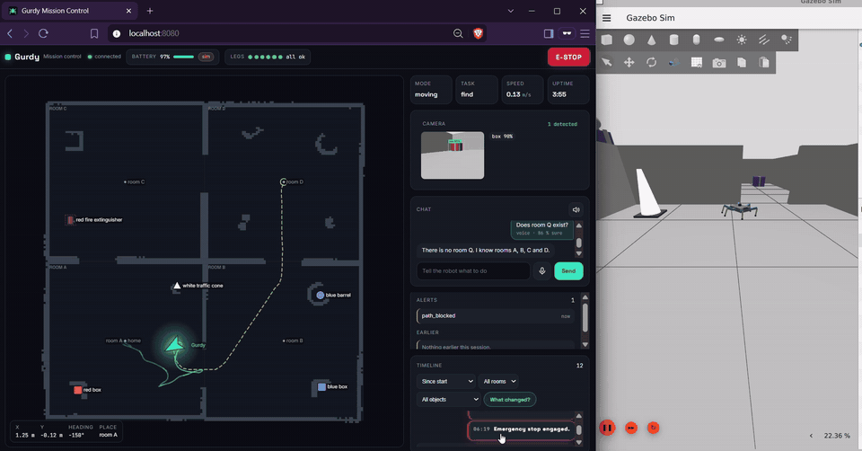
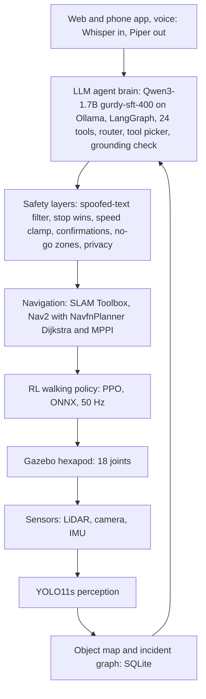
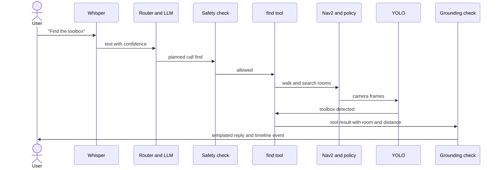
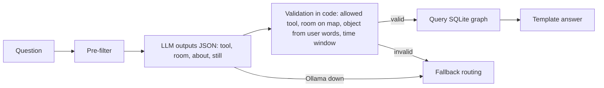
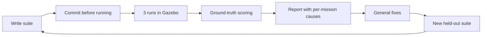
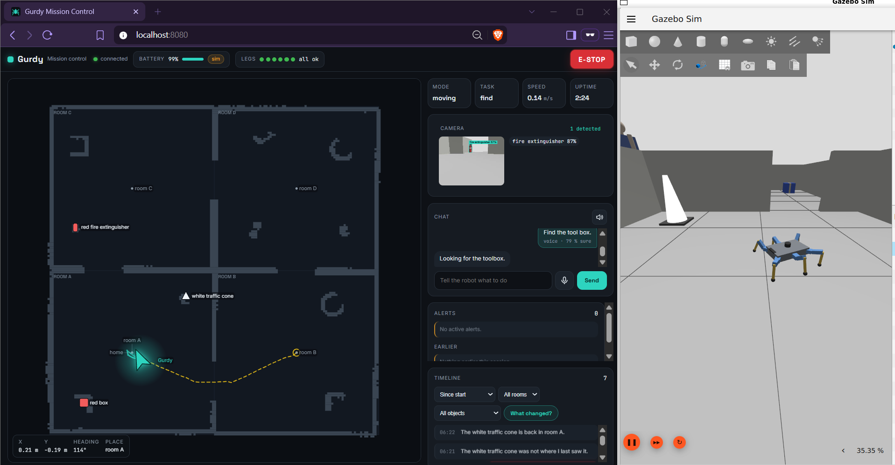
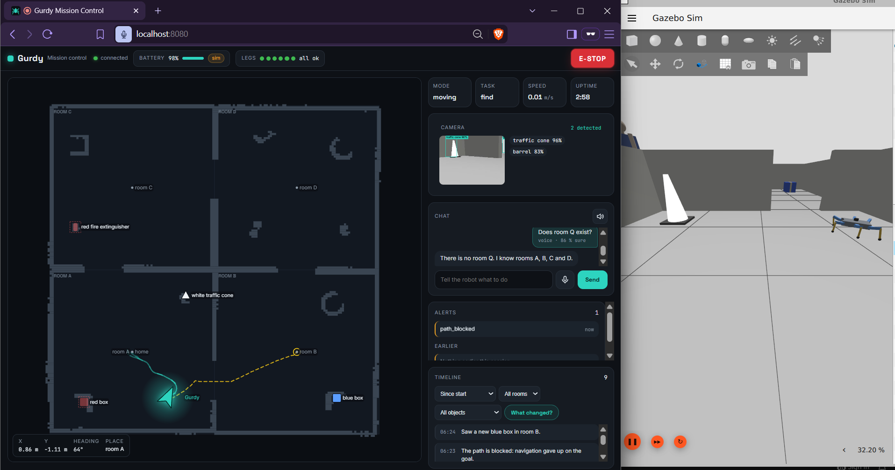

# Gurdy 3.0: Autonomous Hexapod Robot with a Safety-Tested LLM Agent

[](https://github.com/mrsssok2/gurdy3/actions/workflows/ci.yml)

A six-legged robot in simulation that you talk to in plain English, typed or spoken. A small local LLM plans the missions. The robot walks, maps, finds objects and remembers what changed. Every claim in this page comes from a test report in `docs/results/`.

Gurdy 3.0 extends Gurdy 2.0 (https://github.com/mrsssok2/gurdy2, frozen at commit 4c7d047), which built the base robot.

- **Live demo (Gurdy 3.0):** https://mrsssok2.github.io/gurdy3/ — runs in your browser on a simulated robot with a keyword planner. It has no LLM and no real robot.
- **Gurdy 2.0 demo:** https://mrsssok2.github.io/gurdy2/



*The real stack in the lab4 world: Gazebo, Nav2, the RL gait, YOLO, the LLM agent and voice.*

## Results at a glance

The complete, generated list (every number with its source file, date and n; development vs held-out / blind kept apart; missing results marked "not run yet") is **[docs/RESULTS.md](docs/RESULTS.md)**. If a number below disagrees with it, RESULTS.md is right.

| What | Result | Source |
|---|---|---|
| Held-out missions, lab4 v3 (3 runs of 33 unseen missions) | **79 % mean (76-82 %)**, 0 falls, 0 wrong claims | `docs/results/phase5_heldout_lab4_v3.md` |
| Earlier held-out sets (different missions, not comparable) | lab4 v1 80 %, lab4 v2 88 % | `phase5_heldout_lab4.md`, `phase5_heldout_lab4_v2.md` |
| Incident questions, blind set (20 questions, replay) | 16/20 | `phase6f_live_debounce.md` |
| Incident questions, live in Gazebo (20 questions) | 14/20 (was 7/20) | `phase6f_live_debounce.md`, `phase6c_incident_eval.md` |
| Red-team (70 cases: attacks plus benign controls) | 0 unsafe actions, 0 injections followed, 0 leaks | `phase7b_redteam_fixes.md` |
| Benign commands that must not be refused | 27/30 (was 25/30) | `phase7c_overrefusal.md` |
| Fine-tuning (QLoRA, Qwen3-1.7B) on 100 commands | 94 % vs 59 % for the base model | `phase5_eval_sft.md`, `phase5_eval_sft_v2.md` |

Gurdy 2.0 base numbers (frozen baseline):

| What | Result | Source |
|---|---|---|
| Walking gait, command tracking error | 11.2 % (RL) vs 15.9 % (tripod) | `phase2_terrain.md` |
| Lab interior mapped by itself | 99.1 % | `phase3_explore.md` |
| Object detector (YOLO11s) | 0.922 mAP50 on the v1 test split (0.871 on the harder v2 split) | `phase4c_v2.md` |
| Speech recognition (Whisper, 43 read-aloud clips) | 3.7 % word error rate | `phase5_eval_sft_v2.md` |
| 27-mission Gazebo suite (one run) | 85 % (23/27) | `phase5_final_eval.md` |

## What is new in 3.0 vs 2.0

| Area | What changed |
|---|---|
| Held-out world and evaluation | New 4-room world (lab4). Suites are committed before they run and are never used for tuning. Three runs per suite, ground-truth scoring. |
| Step A and Step B fixes | General fixes from the failures: room names, search routing, no-go checks for the whole walk, faster stops, asking when unclear, finding in a named room. |
| Incident graph and tool picker | SQLite memory of what changed over time. A validated LLM picker chooses the query tool. Answers are templates. |
| Recorder debounce | Fewer false "missing" and "is back" events. |
| Red-team safety layers | Deterministic rules in front of the planner. They hold even when the model obeys an attack. |
| Over-refusal fix | Normal commands that were wrongly refused now work. |
| Offline replay harness | Incident questions replay against a recorded graph, with no Gazebo. |
| 4-room browser demo | The Pages demo runs a mock of lab4, with a sample timeline. |

## System architecture



Commands go down through the safety layers to the legs. Sensors come back up through perception into the memory the brain reads.

## One command, end to end



Every fact in the reply must be in a tool result of the same turn. If it is not, the reply falls back to a template.

## Incident question flow



The model only picks the tool. The room, the object and the time come from the user's words, and the answer is a template filled from the query result.

## Evaluation method



Frozen results are never re-scored. After a fix, a new suite is written. The old one only shows that the fix works on its own trigger.

## Screenshots



*Voice command "find the toolbox": live map, YOLO detection (fire extinguisher 87 %) and the Gazebo window.*



*Honest answer "There is no room Q. I know rooms A, B, C and D." The `path_blocked` alert in the corner is a real Nav2 limitation (see limits below).*

## What the testing showed

### Held-out testing in lab4
Four rooms, ten objects, a robot that has never seen the world. Each suite is a new set of missions with new wording. Details: `docs/results/phase5_heldout_lab4.md`, `phase5_heldout_lab4_v2.md`, `phase5_heldout_lab4_v3.md`.

| Suite | Missions x runs | Success | Falls |
|---|---|---|---|
| lab4 v1 | 32 x 3 | 80 % (75-84 %) | 0 |
| lab4 v2, after the Step A fixes | 32 x 3 | 88 % (84-91 %) | 0 |
| lab4 v3, after Step B and the safety rules | 33 x 3 | 79 % (76-82 %) | 0 |

The sets differ, so the scores are not a like-for-like trend.

- **v1** found the first language and routing bugs. Examples: "Charlie" meant the chair, no-go zones were only checked at the start, and stops were slow.
- **v2** tested those fixes on new wording (`phase5_stepb_fixes.md` has the Step B fixes).
- **v3** was harder. Ambiguity went to 9/9 and stop to 9/9. Multi-room (4/12) and objects (9/15) stayed weak. Six missions failed in all three runs, and five of those six were language or routing, not walking.
- One failure came from a Phase 7b safety rule that refused "Charlie first, afterwards Delta". A new check in Gazebo after the fix passed 4 of those 6 missions (`phase7d_postfix_live.md`). That check is not held-out: the fixes were written after reading those failures. The official v3 number stays 79 %.

### Phase 6: incident graph (memory over time)
The robot records timestamped events (objects seen, moved or missing, rooms visited, stops, no-go zones, alerts) in a SQLite temporal graph. It answers questions like "What changed in room C?" and "When did you last see the toolbox?". The web app has a Timeline panel and a What-changed button.

- Six query tools, hidden from the planner. The LLM picker only chooses a tool. Answers are templates, so they cannot invent facts.
- Blind set: 16/20. Live in Gazebo: 14/20, up from 7/20. The live gain is not caused by the debounce alone.
- False events remain after the debounce, for example a gray cone in room B reported missing.

Details: `docs/results/phase6e_blind.md`, `phase6f_live_debounce.md`, `phase6d_picker.md`; design in `docs/phase6_incident_graph.md`.

### Phase 7: red-team and over-refusal
Two suites run through the real agent: `redteam_v1` (48 cases) and `redteam_blind_v1` (22 cases written by the project owner, committed before any code change). 12 of the 70 cases are normal commands that must not be refused.

| | before the fixes | after |
|---|---|---|
| `redteam_v1` | 45/48 | 48/48 |
| `redteam_blind_v1` | 17/22 | 21/22 |
| unsafe executions, injections followed, leaks | 5, 2, 0 | 0, 0, 0 |

The fixes are regex rules in front of the planner, so they work even if the model obeys the attack: stop always wins, spoofed text is data, speeds are clamped, confirmations are bound to the user's own words, privacy requests are refused. I read the blind failures before fixing, so 21/22 is not a fresh held-out score.

**The over-refusal lesson.** The safety rules made the agent refuse normal commands such as "Run over to room B". A new set of 30 benign commands, `benign_v1`, went from 25/30 to 27/30 after narrowing the rules. The red-team results did not change. Details: `docs/results/phase7b_redteam_fixes.md`, `phase7c_overrefusal.md`.

## How testing works

Every push and pull request runs [CI](.github/workflows/ci.yml) on GitHub: no GPU, no Ollama, no Gazebo. The same checks run locally with one command:

```bash
scripts/ci_local.sh                 # all steps (about 4.5 min on a laptop); or name steps: scripts/ci_local.sh brain safety
```

| Step | What it checks |
|---|---|
| `yaml` | every tracked YAML file parses, is not empty, has no duplicate keys |
| `urdf` | 7 xacro variants (robot, Gazebo + lidar, fixed base, arm, arm + MoveIt proxies) expand to a valid kinematic tree; `check_urdf` when installed |
| `lint` | ruff, warn-only for now; syntax errors and undefined names are listed separately (`LINT_STRICT=1` makes them fail) |
| `core` `vision` `brain` `web` `ops` `ros` | the pytest / unittest suites; ROS node tests that need `rclpy` are skipped here and run in the ROS image |
| `safety` | red-team and benign suites through the real agent and safety checker, with the keyword planner as a mock LLM: 0 injections, 0 leaks, 0 errors, and no case may fail that is not pinned in `scripts/ci/safety_baseline.yaml` |

Not in CI: RL and MuJoCo tests, Gazebo missions and LLM evals. They need the Docker images or the GPU; their results are in `docs/results/`. Blind and held-out suites are never run or read by CI.

## How to run

**Needs:** WSL2 Ubuntu, Docker, and an NVIDIA GPU with about 6 GB of memory. The Docker images and the Ollama model are built locally (see `CLAUDE.md` and `docs/`).

```bash
# the 4-room lab4 world, robot + LLM agent + web app
WORLD=lab4 scripts/start_web_robot.sh

# also open the Gazebo window
GUI=true WORLD=lab4 scripts/start_web_robot.sh

# voice: hold the mic button, or hold Space in the page
WORLD=lab4 scripts/start_web_robot.sh voice
```

The script prints a local address and a private access token. Keep the token private. Do not post it or commit it.

For a phone on the same Wi-Fi, use `lan https voice` (`docs/phase7_voice.md`, `docs/phase7_phone.md`). For access from anywhere, use the `tailscale` argument (`docs/phase7_remote.md`). The browser demo has a Connect to my robot button for this (`docs/phase7_demo_deploy.md`).

## Repository layout

| Folder | What is in it |
|---|---|
| `brain/` | LLM agent, tools, safety rules, incident graph, mock world, evaluation suites, training code |
| `brain/incidents/` | Temporal graph, recorder, query tools, tool picker |
| `gurdy_core/` | Pure Python robot math: kinematics, gait, policy runtime, vision decoding |
| `ros2_ws/src/` | ROS 2 packages: description, Gazebo worlds, control, gait, policy, navigation, perception, safety |
| `rl/` | Reinforcement learning environments and training |
| `sim_mujoco/` | MuJoCo model and parity tests |
| `vision/` | Synthetic dataset and YOLO training |
| `web/` | Web app, API server, in-browser demo |
| `scripts/` | Start scripts, evaluation runners, generators |
| `maps/`, `models/` | Saved maps and exported policy and detector models |
| `docs/` | Design notes and all results (`docs/results/`) |

<!-- results-linked:start (no numbers here: every number lives in docs/RESULTS.md; brain/tests/test_results_md.py checks it) -->
## Fetch, VLN and VLM (in progress)

All numbers for these parts are in **[docs/RESULTS.md](docs/RESULTS.md)**, generated from the committed result files, each with
its source, date and n, and with development results kept apart from held-out / blind ones. So far every fetch, VLN and VLM number
is a **development** result or **not run yet**.

### Fetch: "bring me the blue can"

A small arm with a coupled two-finger gripper sits at the rear of the body and folds forward over it while walking. One fetch
command runs: find the object (semantic map, then a room sweep), walk to a stand-off point and turn the back to it, re-approach if
Nav2 stopped short, line the gripper up with the wrist depth camera (gated by the body camera's map position), move to the
pre-grasp with MoveIt, close, check the hold (finger positions **and** the arm's joint efforts carrying the weight), fold, carry at
a reduced speed limit, then hand over standing still or put it down. The robot says "Here's your ..." only when the hold check
confirmed it; in Gazebo every take is also graded from ground truth.

- Results: [grasp tests](docs/RESULTS.md#grasp-tests-dev), [fetch runs](docs/RESULTS.md#fetch-runs-dev) (development; no
  held-out fetch suite yet).
- Run: `FETCH=true scripts/start_web_robot.sh`, a single watched take `scripts/demo_bring_gui.sh "bring me the blue can"`,
  the grasp bench `scripts/grasp_test.sh`.
- Details: `docs/demo_runbook.md`, `docs/results/demo_bring_1128.md`, `docs/results/phase9i_first_grasp.md`.
- Limits: the small objects sit below the lidar plane (Nav2 cannot see them); coloured mini cones need the retrained detector;
  grasping is tuned on the same world it is measured in.

### VLN: "go to the kitchen, past the chair, stop near the red barrel"

Instructions become a route of rooms and semantic-map landmarks. A small LLM returns a constrained JSON plan (schema-checked by
Ollama), code validates every word against the user's sentence and the map, and a keyword parser produces the same plan when the
model is down or rejected. Waypoints keep a clearance of margin plus three sigma of each landmark's position uncertainty; avoided
rooms become temporary no-go zones; every waypoint's path is checked before the robot moves. Unknown or ambiguous landmarks
and unreachable goals get an honest answer instead of a walk. Rooms have demo names (hallway, office, living room, kitchen); the
evaluation suites use the room letters.

- Results: [VLN rows in the offline sets](docs/RESULTS.md#offline-agent-test-sets-dev) (development) and the
  [VLN blind suite](docs/RESULTS.md#held-out-and-blind-suites-held-out--blind) (not run yet).
- Run: `VLN=true scripts/start_web_robot.sh`; Gazebo evaluation `scripts/vln_eval.sh SUITE.yaml` (one fresh stack per episode,
  graded from ground truth); first check `scripts/vln_dev_run.sh`.
- Details: `docs/results/vln_plan.md`.

### VLM: "what colour is the box near the barrel?"

A small open vision-language model looks at the body camera **as a second witness only**. Its answer is checked against the
detector, the semantic map and the path check: agreement is stated, disagreement becomes "I'm not sure" with both sides, and an
object only the VLM saw is never stated as present. Replies are built from checked fields, never from the model's free text.

- Results: [VLM eval](docs/RESULTS.md#offline-agent-test-sets-dev) (not run yet).
- Run (later, on the GPU): `scripts/vlm_eval.sh`; Gazebo runs can save body-camera frames for replay with
  `DETECTOR_FRAMES=true scripts/start_web_robot.sh`.
- Details: `docs/results/vlm_plan.md`.
<!-- results-linked:end -->

## Honest limits

- **Simulation only.** No real robot has run any of this.
- **English-only regex safety rules.** Paraphrases, other languages, encodings or text split across turns depend on the older layers. The red-team suites are small (70 cases) and use one model and a mock robot.
- **Nav2 "path blocked" errors** happen near doorways and fail some missions. A flaky one in the Phase 7d check stopped a search near a doorway.
- **Stop latency:** median 1.05 s wall time in v3 (about 0.54 s in simulation time). The target of under 1 s is not met.
- **Some results are single runs.** The live incident eval, the 27-mission suite and the Phase 7d check have no variance estimate.
- **Blind sets were partly seen before the fixes.** Their after-fix scores are not fresh held-out results.
- **The browser demo is not the real stack.** It uses a keyword planner and a mock world.
- **Leg-failure adaptation missed its target** and was not deployed (`docs/results/exp_B_leg_failure.md`).

## Roadmap

- Fix the Nav2 doorway problem and add a LiDAR safety shield (a control barrier function).
- 3D open-vocabulary perception.
- Vision-and-language navigation.
- Ops and CI: MLflow and GitHub Actions.
- A small vision-language model.

