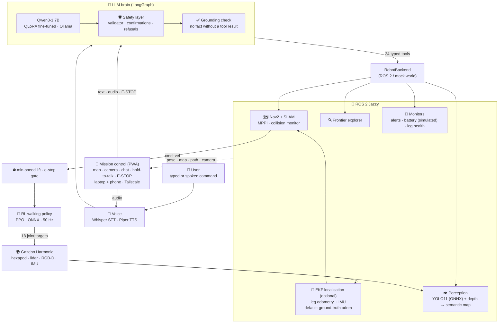
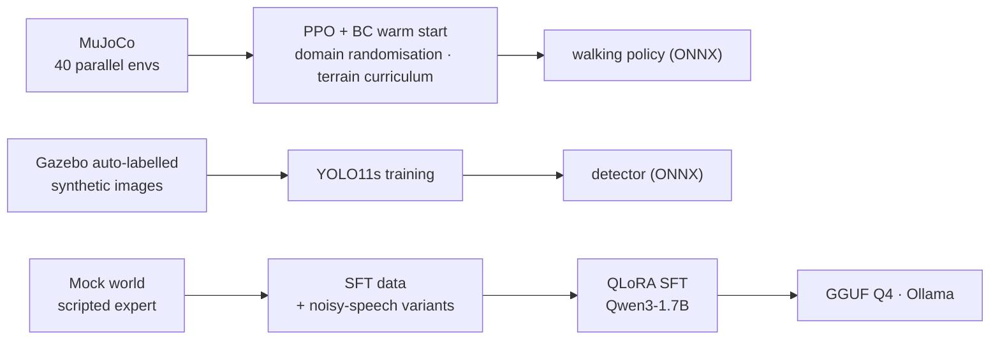

# Gurdy 3.0

Builds on Gurdy 2.0 (github.com/mrsssok2/gurdy2, frozen at commit 4c7d047c490efefdce13526f18f7db52b700e327). Everything below is the Gurdy 2.0 baseline; Gurdy 3.0 results will be added next to it (see ROADMAP.md).

**Try the live demo: [mrsssok2.github.io/gurdy3](https://mrsssok2.github.io/gurdy3/) - runs in your browser, voice included.** Press *Connect to my robot* on that page to drive your own robot over Tailscale.

**What it does:** a six-legged robot in simulation that you can talk to in plain English, typed or spoken (Whisper on the GPU, ~0.3 s per command, 3.7 % word error rate). It walks with a learned (reinforcement-learning) gait, maps and explores a building on its own, recognises objects by name, and plans missions with a fine-tuned LLM running locally.
**What it proves:** the whole stack runs offline on one 6 GB laptop GPU. Measured: the learned gait tracks commands more accurately and uses less energy than a classic gait, the robot mapped 99 % of a lab, found 11/11 objects, and the fine-tuned LLM scored 94 % vs 59 % for the base model on 100 commands, with no hallucinated replies reaching the user.
**What did not work:** it is simulation only, 72.5 % on unseen casual phrasing, and leg-failure adaptation missed its target (see Known limitations).

## Voice control in Gazebo

Spoken English goes through push-to-talk, Whisper on the GPU and the same agent as typed input; the robot answers aloud.

|  |  |  |
|---|---|---|
| Go to room B and find the red box: it reports the box is really in room A | Go home: arrives 0.1 m from the goal | Stop heard in 0.3 s, then find the red box |

## Mission control app (laptop + phone)

A PWA mission-control dashboard: live SLAM map, planned path, camera with detections, chat + hold-to-talk voice and an E-STOP. It works on a laptop and a phone, and privately from anywhere via Tailscale (`scripts/start_web_robot.sh tailscale voice`, [setup](docs/phase7_remote.md)).

The live demo is a static page (the real Python simulation runs in your browser, first visit ~6 MB; [how it is built](docs/phase7_demo_deploy.md)).


*The public demo page (mrsssok2.github.io/gurdy3) connected to the real robot via Tailscale: spoken 'Go to room B' (84 %, GPU Whisper on the laptop), the robot walking through the doorway in Gazebo (right).*

|  |  |
|---|---|
| Voice from my phone over 4G: Whisper on the laptop GPU, fine-tuned LLM, E-STOP latch and release | Phone map: planned path through the doorway and the walked trail |

Stack: fine-tuned Qwen3-1.7B (LoRA, Ollama) as the planner · PPO-trained RL gait · slam_toolbox + Nav2 · YOLO11 trained on self-generated synthetic images · mission-control web app (stdlib Python server + no-build PWA, Tailscale Serve for private remote access). Everything runs offline (the remote link is optional): ROS 2 Jazzy · Gazebo Harmonic · MuJoCo · Docker (WSL2) · MIT.

**Demo (68 s):** [docs/videos/gurdy2_demo.mp4](docs/videos/gurdy2_demo.mp4) — tripod gait vs the RL policy on a 12° slope and 4 cm steps
(MuJoCo), then autonomous exploration of a lab from an empty map (Gazebo + Nav2 + slam_toolbox).


## Architecture

Runtime:



The LLM decides what to do, Nav2 decides where to go,
and the RL policy decides how to move the 18 joints.
(Typed and spoken commands, from the terminal or the web app, drive the same agent; voice code: `brain/voice`, web app: `web/`.)

Training:



## Headline results (all measured; details linked)

| Area | Result | Details |
|---|---|---|
| RL walking vs tripod gait (MuJoCo) | tracking error 10.6 % vs 15.9 %; cost of transport 5.77 vs 7.35; 0 % falls in all randomisation scenarios; slope 12° 93 % (tripod 100 %); steps 4 cm 83 % (tripod 57 %) | [Experiment A](docs/results/exp_A_terrain.md) |
| Sim-to-sim (MuJoCo → Gazebo) | 0 falls, but tracking differs by up to 14 points on single axes (target ≤ 10 **not met**) | [deploy](docs/results/phase2_deploy_gazebo.md) |
| Mapping (Gazebo) | mean map error 3.1 cm (policy) / 2.4 cm (tripod); autonomous exploration 99.1 % of the lab mapped, Nav2 5/5 goals | [Phase 3](docs/results/phase3_gazebo_results.md), [exploration](docs/results/phase3_explore.md) |
| Object detection (YOLO11s, synthetic data) | test mAP50 0.922 (v1 test) / 0.871 (harder v2 test); 11/11 objects found in a Gazebo lab, median position error 0.031 m (xy) | [Phase 4](docs/results/phase4c_v2.md) |
| LLM brain, 100 in-distribution commands | base Qwen3-1.7B 59 % → fine-tuned **94 %** (keyword baseline 55 %); 0 risky actions executed | [SFT eval](docs/results/phase5_eval_sft.md) |
| LLM brain, 40 unseen casual phrasings | base 42.5 % → fine-tuned **72.5 %** (current agent code; test set written by an AI assistant, not by humans) | [OOD eval](docs/results/phase5_eval_sft_v2.md) |
| Hallucinated replies | 0 hallucinated replies reached the user (28 checked; the grounding check blocks any fact not in that turn's tool results: 0 needed blocking for the fine-tuned model, 4 for the base model) | [SFT eval](docs/results/phase5_eval_sft.md) |
| Live LLM-driven Gazebo missions | 9/9 typed missions completed (go-to, find, patrol, stop, refusal, clarification) | [live test](docs/results/phase5_live_test.md) |
| Final Gazebo evaluation (27 scripted missions, fresh stack per mission, judged against ground truth) | **85 % (23/27)** succeeded, 0 falls, 0 false claims; median stop latency 0.94 s; one run per mission, no variance | [final eval](docs/results/phase5_final_eval.md) |
| Voice (read-aloud, 43 real clips) | word error rate 3.7 %, exact-command accuracy 86 %, speech-to-text ~0.3 s per clip on the GPU | [voice eval](docs/results/phase5_eval_sft_v2.md) |
| Leg-failure adaptation (negative result) | missed the < 40 % criterion, worse than the open-loop tripod; not deployed | [Experiment B](docs/results/exp_B_leg_failure.md) |

Per-phase tables and RL training commands: [docs/RESULTS.md](docs/RESULTS.md). All write-ups: [docs/results/](docs/results/). The selected walking policy everywhere is `terrain_dr2` 15M.

## Live run

The fine-tuned brain driving the robot in Gazebo through typed tools (9/9 missions, [details](docs/results/phase5_live_test.md)).

| Gazebo lab | Chat transcript |
|---|---|
|  |  |

## Quick start

**Needs:** Linux or WSL2 with Docker and the NVIDIA container runtime (an NVIDIA GPU with ≥ 6 GB VRAM; tested on an RTX 4050 Laptop), and [Ollama](https://ollama.com) (this project runs its own instance on port 11435).

```bash
docker compose build sim brain                # ROS 2 / Gazebo image + brain image
scripts/start_agent_chat.sh                   # Gazebo + Nav2 + policy + detector + Ollama brain, then a text chat
```

**The `gurdy-sft-400` model is not published yet** (publishing it on Hugging Face is planned), so build it yourself. The script expects an Ollama model with that name:
1. Generate the SFT data and fine-tune Qwen3-1.7B with QLoRA: `scripts/p5_datagen.sh`, then `scripts/p5_sft.sh` ([data](docs/results/phase5_datagen.md)).
2. Start this project's Ollama (`OLLAMA_MODELS=~/ollama_models LD_LIBRARY_PATH=/usr/lib/wsl/lib ~/ollama/bin/ollama serve`, it listens on 11435), then build and register the model with one command (CPU only, pinned llama.cpp b12494, no GPU needed):
   ```bash
   scripts/build_gguf.sh brain/runs/sft_v1 400 gurdy-sft-400     # <run_dir> <step|final|best> <ollama_name>   (--dry-run prints the plan)
   ```
   It merges the LoRA adapter into the fp16 base, converts to GGUF, quantises to Q4_K_M and runs `ollama create` with `brain/tools/Modelfile.sft` (the exact training prompt template). Finished stages are skipped on re-run ([details](docs/results/phase5_eval_sft.md)).

Without the LLM: `docker compose up sim` starts the walking robot in Gazebo (teleop commands in [docs/RESULTS.md](docs/RESULTS.md)). Retraining the walking policy: [docs/RESULTS.md](docs/RESULTS.md#rl-training-commands-phase-2).

## Known limitations
- **LLM:** 72.5 % on unseen casual phrasing; it still invents tool names and unsupported actions on some inputs (nothing invented was executed). The OOD set is assistant-written; noisy-speech cases in the main set are hand-written, not real Whisper output. The 9-mission live test was typed; voice was checked live on a few commands and on 43 read-aloud clips, not on a full mission suite.
- **Hexapod walking:** policies stand still for tiny commands from rest (handled at deployment by lifting Nav2 commands to ≥ 0.09 m/s); steps ≥ 4 cm still fail 17–37 % of episodes for every controller.
- **Web app:** used on Chrome (laptop) and Android Chrome (phone over Tailscale); not tried on iOS. The public demo is a static in-browser build (GitHub Pages), keyword planner only. Battery and the leg faults shown are simulated.
- **Sim only:** no real robot. Sim-to-sim gap up to 14 points (31 on one combined segment). Leg-failure adaptation did not work.
- **Single runs:** Nav2, exploration and detector-in-Gazebo were run once per setting, in one world (`flat_lab` / `semantic_lab`); no variance estimates.
- **Perception:** a table and a cylinder are still labelled `box` (7 false tracks in the lab run); detector trained on synthetic images only. Battery is simulated.
- Gazebo RTF drops to ~0.35–0.6 with Nav2 + policy + detector; results are in sim time.

## Status (2026-11-19)

Phases 0–4 and the Phase 5 core (LLM brain, 27-mission Gazebo evaluation) are done. Phase 7 (mission-control web app, voice in the browser, private remote access) is done except deploying the public demo. Phase 6 (robot incident graph) is paused after step 1; Phases 8–9 are not started. See [ROADMAP.md](ROADMAP.md) and [CLAUDE.md](CLAUDE.md).
